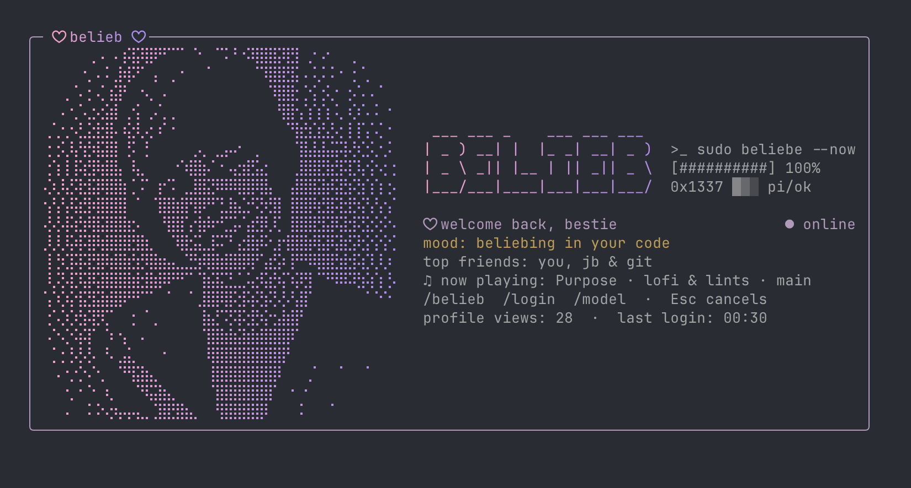

# ♥ belieb ♥



```text
~*~*~ ♥ x3 ♥ LOL ~*~*~
Mood: beliebing
Now playing: the sound of your tests going green
Online Now! · Friends: 1 (it's you, and Pi is your Top 1)
```

omg hi!!! ♥ ok so u know how everyone is like "u NEED an AI coding agent" and
ur like "but where is the swoop"?? well NOW there is **belieb**: a *real* coding
agent with a hand-drawn terminal avatar, a Myspace profile card, and exactly
the right amount of pink + purple. ily. 💜

> **Disclaimer (the boring-but-important part, sry!!)** belieb is an unofficial,
> independent Bieber-inspired parody, powered by [Pi](https://github.com/earendil-works/pi).
> Not affiliated with or endorsed by Justin Bieber, his representatives, or Pi.
> The model is a totally normal coding assistant. The parody is *presentation only*.
> No fake model responses, no extra agent orchestration. Just vibes. ♥

---

## ~ about me ~

**belieb** wraps Pi's real coding agent (read / bash / edit / write tools,
streaming, auth, model picker, sessions, cancellation) and swaps out the look:

- an ASCII `BELIEB` wordmark + Myspace-style profile card at startup
- a pink-to-lilac gradient (drops away with `NO_COLOR=1`)
- a footer that stays visible while you work
- **beliebing…** whenever the model is thinking

Everything cosmetic only happens in the interactive terminal UI. Print, piped,
JSON and RPC output get no banner, no status messages, no styling. Promise!!

## ~ who i'd like to meet ~ (install)

Needs **Node.js 22.19+** and npm. This first release is **not on npm yet**, so
grab it from source:

```sh
npm ci --ignore-scripts
npm run build
npm link
cd /path/to/your/project
belieb
```

No linking? No prob: `node /path/to/belieb/dist/cli.js`.
Want a portable file? `npm pack`, then
`npm install -g --ignore-scripts /path/to/belieb-0.3.0.tgz`.

## ~ first dance ~ (sign in and code)

Start `belieb` in your project, then:

1. `/login` to connect a subscription or API key
2. `/model` to pick a model
3. type something. that's it!!

You can also use your provider's usual env var (`ANTHROPIC_API_KEY`,
`OPENAI_API_KEY`, ...). Subscriptions and billing are handled by the provider.
**Never commit credentials.** (Never say never to everything else tho.)

```sh
belieb "Explain this repository"
belieb --continue
belieb --resume
belieb --model anthropic/claude-sonnet-4-5
belieb --plan "Find why the auth tests flake"
belieb --print "Summarize this repository"
git diff | belieb --print "Review this diff"
belieb --mode json "List the project entry points"
belieb --mode rpc
```

Press **Esc** to interrupt a run. `/quit` to exit.

**Heads up, bestie:** tools can modify files and run commands with *your user's
permissions*. Only point belieb at projects you want it to edit.

Using DeepSeek? `/login deepseek`, paste your key, then `/model` and pick
`DeepSeek V4.1 Flash` (`deepseek/deepseek-flash`) or `DeepSeek V4 Pro`
(`deepseek/deepseek-v4-pro`), or just set `DEEPSEEK_API_KEY`. Keys are stored in
the shared `~/.pi/agent/auth.json`.

`belieb --help` is Pi's complete, unmodified help: just read `pi` as `belieb`.
`belieb --version` reports the pinned **Pi runtime (1.4.0)**; this wrapper is
**0.3.0**. All arguments are forwarded without shell interpolation, including
`--` and `@file` attachments.

## ~ my top friend ~ (Pi settings, shared!)

belieb shares Pi's standard `~/.pi/agent` credentials, settings, extensions and
sessions, plus project `.pi` config. Want your own space? Make a private profile:

```sh
PI_CODING_AGENT_DIR="$HOME/.belieb/agent" belieb
```

Details for the nerds ♥

- The presentation extension always loads, so `--plan` and the prompt templates
  work in `--print`, JSON, RPC and piped runs too.
- `--use-theme` keeps *your* theme. `NO_COLOR=1` keeps the layout, drops the color.
- Pi's semantic error, diff and syntax colors are kept.
- Editor, shortcuts, transcript and session controls are unchanged. belieb only
  replaces the header, footer, title, working indicator and accent palette.
- `--no-extensions` follows Pi: it disables *discovered* extensions, but the
  presentation extension is explicit, so it still loads.
- Package-management commands are forwarded unchanged. Bump the pinned runtime
  through the dependency manifest, not `belieb update self`.

## ~ my besties ~ (MCP servers)

MCP just works, because it's Pi's built-in support (stdio + streamable HTTP, OAuth):

```sh
belieb mcp add filesystem -- npx -y @modelcontextprotocol/server-filesystem .
belieb mcp add docs --url https://example.com/mcp --bearer-token-env-var DOCS_TOKEN
belieb mcp list
```

Servers live in `~/.pi/agent/mcp.json` (or `.pi/mcp.json` in a trusted project) in
the same format as Claude Code and Cursor. Inside belieb, `/mcp` is Pi's manager
(connect, sign in, exposure, enable/disable) and `/reload` picks up edits.

**Who's online?** Connected servers show in the footer as `mcp 2`, and
`/belieb mcp` lists each one with its tool count. `/belieb stats` has the names too.
A server that failed to connect (or has zero tools) isn't listed; `/mcp` shows why.
`--no-mcp` turns it all off for one run. More in the
[Pi MCP docs](https://github.com/earendil-works/pi/blob/v1.4.0/packages/coding-agent/docs/mcp.md).

## ~ the footer ~ (status bar, but make it a song)

```text
♥ belieb · claude-sonnet-4-5 · main · ctx 42% · $0.42 · mcp 2 · tests ✓ · ♪ working
```

First comes the mode: `♥ belieb` for normal coding, `⏸ plan` while planning.
On narrow terminals segments drop from least to most important: session cost,
then context usage, then branch, then model.

What it says while it works:

| Doing | belieb says |
| --- | --- |
| reading | learning the choreography… |
| editing | recording vocals… |
| tests and commands | soundcheck… |
| git | boarding the tour bus… |
| thinking | beliebing… |

About 1 thinking phase in 100, it says `Freemasons run the country...` instead.
Rare flash, not a whole-run theme. `BELIEB_RARE=always` or `BELIEB_RARE=never`
to force or kill it.

After a test, lint or build command the footer adds a badge like `tests ✓`,
`lint ✗` or `build ✓`. Each kind keeps its own state (`tests ✗ · lint ✓`), and
other extensions' `setStatus()` text stays visible.

## ~ modes ~ (plan vs belieb)

`/mode` opens a picker:

- `⏸ plan`: "You're the next chart hit — read-only."
- `♥ belieb`: "Never say never — full tools and edits."

Toggle directly with `/plan`, `Ctrl+Alt+P`, or `--plan` at startup. In plan mode
edit and write are disabled, bash is limited to read-only commands, and the agent
gives you a numbered plan instead of changes. `2>&1` and `2>/dev/null` still
count as read-only. `curl` is allowed unless it can write or mutate (`-o`, `-O`,
`-T`, `-X`, `-d`, `-F`). Return with `/plan`, `/mode`, or `/belieb belieb`.

This guards Pi's built-in tools. It's a workflow mode, **not an OS sandbox**:
`env` or `cat .env` can still show secrets to the model.

## ~ undo, redo, cost ~ (oops i did it again)

- **`/undo`** reverts the whole previous turn: files changed via `edit`/`write`
  are restored, files it created are removed.
- **`/redo`** replays the turn you just undid. New agent work clears the redo chain.
- Snapshots are session-local and capped: 30 turns, 8 MB total, 512 KB per file.
  **Changes made through bash are not covered.**
- **`/cost`** shows total cost, tokens in/out, cache reads/writes and context
  usage (same numbers as `/belieb stats`), following Pi's own bookkeeping.

**Finish notifications** are opt-in: `/belieb notify on` (or `BELIEB_NOTIFY=1`)
sends an OSC 9 desktop notification and sets the tab title to `♥ belieb · done`
for runs of 20s or more (`cancelled` if aborted). `/belieb notify off` to stop.

## ~ commands ~

| Command | Effect |
| --- | --- |
| `/mode` | Pick plan or belieb from a panel |
| `/undo` | Revert every file change from the last turn |
| `/redo` | Re-apply the change reverted by `/undo` |
| `/cost` | Session spend, tokens and context usage |
| `/belieb notify on` / `off` | Finish notifications for long runs |
| `/belieb mood <name>` | Switch palette: `purpose` (default), `changes`, `justice`, `peaches`, `myworld` |
| `/belieb mood` | Pick a mood interactively |
| `/belieb plan` / `/belieb belieb` | Enter plan mode / return to normal coding |
| `/belieb off` / `/belieb on` | Plain mode: remove theme, header, footer and decoration |
| `/belieb mcp` | List connected MCP servers and their tool counts |
| `/belieb card` | Print the profile card in the transcript |
| `/belieb stats` | Tour stats: mode, model, context, tokens, cost, turns, tools, files, undo, branch |
| `/belieb credits` | Photo, Pi and license attribution |

Pi tags `/` menu commands by source: `[u]` user, `[p]` project, `[t]`
temporary/command-line. belieb's extension and prompts ship with the wrapper, so
they show as `[t]`. A hint like `[focus]` means an optional argument
(`/soundcheck security`); a counter like `(31/46)` is your position in the list,
not a filter. The profile card is a custom session entry: it shows in the
transcript but is never sent to the model.

### Prompt templates (the setlist)

| Command | What it does |
| --- | --- |
| `/soundcheck` | Review the diff |
| `/purpose` | Plan first |
| `/sorry` | Fix red tests |
| `/encore` | Recap and next steps |
| `/setlist` | Draft a commit message |

They're plain templates discovered through the extension, so nothing gets written
to `~/.pi`. `--no-prompt-templates` turns them off.

## ~ my settings ~ (config)

Preferences live in `~/.belieb/config.json` (`BELIEB_DIR` changes the directory):

```json
{ "mood": "purpose", "plain": false, "notify": false }
```

- `BELIEB_PLAIN=1` forces plain mode for one run without touching the file.
- `BELIEB_NOTIFY=1` / `0` overrides the saved notification preference.
- With `--use-theme`, a mood is saved but not applied (you asked for your own palette).

More on providers, RPC, tools and sessions in the pinned
[Pi docs](https://github.com/earendil-works/pi/tree/v1.4.0/packages/coding-agent/docs).

## ~ behind the scenes ~ (develop and verify)

```sh
npm ci --ignore-scripts
npm run build
npm run typecheck
npm test
npm pack --dry-run
```

How it's wired:

- `src/cli.ts` loads Pi's shipped CLI in-process, so Pi owns signals, terminal
  cleanup, auth and execution.
- `src/args.ts` adds the presentation extension without parsing your arguments.
  It only turns the boolean `--plan` into `--plan=true`, because Pi's extension
  flag pre-pass would otherwise swallow the prompt after it.
- `src/extension.ts` hooks Pi's typed extension API (`session_start`,
  `turn_start`, `tool_execution_start`, `agent_settled`, entry renderers,
  `/belieb`, `/undo`, `/redo`, `/cost`).
- `src/branding.ts`: theme, header, footer, title, working indicator, badges.
- `src/card.ts`: the Myspace card and panels.
- `src/palettes.ts`, `config.ts`, `plan.ts`, `checkpoints.ts`, `usage.ts`,
  `checks.ts`, `notify.ts`, `commands.ts`: moods, preferences, plan mode,
  undo/redo, cost, check badges, notifications, command handlers.

Tests cover argument fidelity, headless UI isolation, footer and working-state
behavior, plan-mode tool restrictions (descriptor redirects, curl write flags),
the mode picker, undo/redo, cost accounting, check badges, notifications, mood
persistence, bundled prompt discovery, and real credential-free CLI help,
version, missing-auth failure, headless `--plan` and RPC state. Paid model
requests and OAuth browser login need your own provider account and are not
automated. Dependencies are pinned with a committed lockfile. Nothing here
publishes a package or pushes to a remote.

## ~ pics ~ (header art)

The startup card pairs a 40 x 20 Braille portrait (dithered from a CC BY 2.0
photo, see [NOTICE](NOTICE); `src/portrait.ts`) with a hand-drawn ASCII `BELIEB`
wordmark, a pink-to-lilac gradient and fake-terminal status lines (see `logo` in
`src/card.ts`). Below 70 columns or 28 rows it collapses to a compact text
header. The gradient is memoized so streaming re-renders stay cheap.

## ~ credits & legal ~

Own code: MIT, see [LICENSE](LICENSE). The terminal portrait is adapted from a
CC BY 2.0 photo by Kevin Aranibar of Kerosene Photography; full attribution,
changes and the unofficial parody notice are in [NOTICE](NOTICE). Names belong to
their respective owners.

---

*thx for stopping by my page!! leave a comment, add me, and never say never to
shipping.* ♥ 💜 ♥

`~*~ xoxo ~*~`
